# WEB404 – Practical 2: Web Command-Line Interface with Command Injection Safeguards

## 1. Objective

1. Build a web application that gives the user a **command-line interface (CLI) in the browser**, where commands typed in a web page are run on the server.
2. Show how a careless implementation is open to **OS command injection**, and exploit it.
3. Add **layered safeguards** so the same CLI is still useful but cannot be abused, and check this with automated tests and manual attacks.

## 2. Background Theory

### 2.1 What is command injection?

**OS command injection** happens when an application builds an operating-system command from user input and runs it through a **shell** (`/bin/sh`, `cmd.exe`). The shell gives special meaning to some characters, so an attacker can end the intended command and add their own. Whatever the attacker runs gets the same privileges as the web server process.

```js
// Vulnerable pattern
exec("ping -c 2 " + userInput);
// userInput = "127.0.0.1; cat /etc/passwd"
// shell runs:  ping -c 2 127.0.0.1 ; cat /etc/passwd
```

### 2.2 Injection techniques (2.5.1)

| Technique | Payload example | Behaviour |
|---|---|---|
| Command separator | `127.0.0.1; whoami` | Runs both commands, one after the other |
| AND chaining | `127.0.0.1 && cat secrets.txt` | Second command runs if the first succeeds |
| OR chaining | `invalid \|\| id` | Second command runs if the first fails |
| Pipe | `127.0.0.1 \| id` | Output of the first is piped into the second |
| Command substitution | `$(whoami)` or `` `whoami` `` | Inner command runs first and its output is put in its place |
| Newline | `127.0.0.1%0awhoami` | A newline acts as a command separator |
| Redirection | `> /var/www/shell.php` | Writes or overwrites files on the server |
| Argument injection | `-c 100000 host`, `--help` | No shell needed: user input is read as **options** of the real program |
| Blind injection | `; sleep 10` | No output comes back; the attacker confirms it worked from timing or out-of-band DNS/HTTP |

### 2.3 Prevention (2.5.2 & 2.7)

1. **Avoid OS commands** when the language or a library can do the job.
2. **Never use a shell.** Pass arguments as an array (`execFile`/`spawn` with `shell:false`) so metacharacters are plain text.
3. **Allowlist** the commands, and validate every argument against a strict allowlist pattern. Blocklists are not enough on their own.
4. **Prevent argument injection**: reject arguments that start with `-`, and use `--` where possible.
5. **Least privilege**: fixed binary paths, a minimal environment, a confined working directory, and a low-privilege user.
6. **Limit resources**: timeouts, output size, input length, and rate limiting.
7. **Error handling and logging**: show generic errors to users and keep a detailed audit log for administrators.

## 3. Tools & Technologies

| Tool | Purpose |
|---|---|
| Node.js 26 + Express 4 | Web server and API |
| `child_process.exec` / `execFile` | Vulnerable vs. secure process execution |
| Helmet | Security headers (CSP, X-Frame-Options, nosniff…) |
| express-rate-limit | Rate limiting on the secure endpoint |
| `node:test` | Automated security tests |
| curl / bash | Command-line attack script |
| Browser (Chrome/Safari) | Web CLI front end |

## 4. Project Structure

```
WEB404_Assingment_2/
├── server.js               # Express app, security headers, rate limiter, routes
├── src/
│   ├── vulnerable.js       # ⚠️ exec() + string concatenation (demo of the flaw)
│   ├── secure.js           # Allowlist + validation + execFile(shell:false)
│   └── logger.js           # JSON-lines audit log (logs/audit.log)
├── public/                 # Browser terminal UI (index.html, app.js, style.css)
├── sandbox/                # The only directory the secure CLI may read
├── private/secrets.txt     # FAKE "sensitive" file used as the attack target
├── tests/injection.test.js # 20 automated tests
├── attack-demo.sh          # Sends each payload to both endpoints with curl
└── screenshots/            # Report screenshots
```

## 5. Implementation

### 5.1 The web CLI

The front end (`public/`) looks like a terminal. It has command history (↑/↓), quick-fill buttons for test payloads, and a switch between **Secure mode** and **Vulnerable mode**. Each command is sent as JSON to `POST /api/secure/run` or `POST /api/vulnerable/run`. Output is always written with `textContent`, never `innerHTML`, so command output cannot cause XSS in the page.

**Supported commands:** `help`, `ping <host>`, `nslookup <domain>`, `ls`, `cat <file>`, `whoami`, `date`, `uptime`, `echo <text>`, `clear`.

### 5.2 Vulnerable implementation (`src/vulnerable.js`)

```js
const TEMPLATES = { ping: (args) => `ping -c 2 ${args}`, cat: (args) => `cat ${args}`, ... };

if (!TEMPLATES[name]) return "Unknown command";        // only the FIRST word is checked
exec(TEMPLATES[name](args), { cwd: SANDBOX }, ...);    // whole string goes to /bin/sh
// response also returns the executed command + full err.stack (information disclosure)
```

**Flaws:** it only checks the first word, it concatenates strings, it runs through a shell, the arguments are not validated, and it leaks stack traces and the exact command line.

### 5.3 Secure implementation (`src/secure.js`)

Every request goes through these layers in order. They overlap on purpose (**defence in depth**): if one layer has a mistake, the next one still stops the attack. For example, a payload with no metacharacters gets past layer 2 but is caught by layers 3–6, and even if every check failed, layer 7 means there is no shell to run injected commands.

| # | Safeguard | Code | Stops |
|---|---|---|---|
| 1 | Max 100 chars, printable ASCII only | `MAX_INPUT_LENGTH`, `PRINTABLE_ASCII` | Oversized input, unicode look-alikes (e.g. fullwidth `；`) |
| 2 | Shell metacharacter detection + logging | `SHELL_METACHARACTERS` blocks ``; & \| ` $ ( ) { } [ ] < > \ ' " ! * ? ~ #`` and newlines/tabs | `;` `&&` `\|\|` `\|` `$()` backticks, redirection, newlines |
| 3 | Command allowlist | `COMMANDS` object + `hasOwnProperty` | `rm`, `curl`, `bash`, prototype keys like `constructor` |
| 4 | Per-argument allowlist regex | `validateHost()` (hostname/IP), `SAFE_FILENAME`, `SAFE_TEXT` | Malformed hosts and file names |
| 5 | Argument-injection block | `args.some(a => a.startsWith('-'))`, `cat -- file` | `ping -c 100000`, `--help`, option smuggling |
| 6 | Path confinement | `path.resolve` + `dirname === SANDBOX`, symlink rejection | `../private/secrets.txt`, `/etc/passwd` |
| 7 | **No shell** | `execFile(binary, argsArray, { shell: false })` | Metacharacters are plain text, even if layers 1–6 had a bug |
| 8 | Least privilege / resource limits | Absolute binary path, `env: { PATH }` only, `cwd: sandbox`, `timeout: 10s`, `maxBuffer: 64KB` | PATH hijacking, env leakage, long-running/DoS commands |
| 9 | Avoid the OS where possible | `echo` is done in JavaScript, no process | Removes the attack surface completely |
| 10 | Generic errors + audit log | `'An internal error occurred.'`, `logs/audit.log` | Information disclosure; gives a record for incident response |
| 11 | Rate limiting | 30 req/min per IP on `/api/secure/run` | Brute force / automated fuzzing |
| 12 | Hardening | Helmet CSP, `X-Frame-Options`, `nosniff`, `x-powered-by` off, 1 KB JSON body limit, bound to `127.0.0.1` | XSS, clickjacking, fingerprinting, large payloads |

Key secure code:

```js
const [name, ...args] = raw.trim().split(/ +/);              // we tokenise; no shell does
if (!Object.prototype.hasOwnProperty.call(COMMANDS, name)) return reject('NOT_ALLOWLISTED', ...);
if (args.some((a) => a.startsWith('-')))                    return reject('ARGUMENT_INJECTION', ...);

ping: { binary: 'ping', buildArgs: ([host]) => ['-c', '2', validateHost(host)] },

execFile('/sbin/ping', ['-c', '2', '127.0.0.1'], { shell: false, cwd: SANDBOX,
         timeout: 10000, maxBuffer: 64 * 1024, env: { PATH: '/usr/bin:/bin:/usr/sbin:/sbin' } });
```

## 6. How to Run

```bash
npm install          # install dependencies
npm start            # http://127.0.0.1:3000
npm test             # run the 20 security tests
./attack-demo.sh     # (in a second terminal, while the server is running)
```

> ⚠️ The vulnerable endpoint is for learning only. The server listens on `127.0.0.1` only. Run with `DISABLE_VULNERABLE=true npm start` to remove it.

## 7. Testing & Results

### 7.1 Installing and starting the application

`npm install` installs the dependencies and reports **0 vulnerabilities**. `npm start` launches the server on `http://127.0.0.1:3000` and lists the secure and vulnerable endpoints.

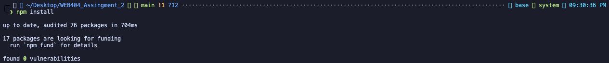

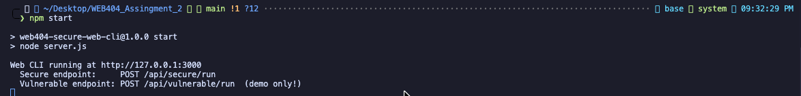

### 7.2 The web CLI working normally (secure mode)

Running `help`, `ping 127.0.0.1`, `ls` and `cat welcome.txt` in secure mode. Legitimate commands still work.

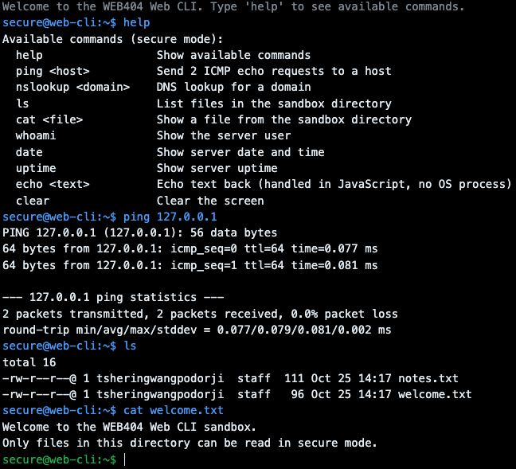

### 7.3 Exploiting the vulnerable mode

| Payload | Result in vulnerable mode |
|---|---|
| `ping 127.0.0.1; whoami` | Ping output **plus the server username** |
| `ping 127.0.0.1 && cat ../private/secrets.txt` | **Database password and API key leaked** |
| `ping 127.0.0.1 \| id` | User ID and all group memberships |
| `echo $(whoami)` / ``echo `uname -a` `` | Command substitution runs; **kernel/OS details leaked** |
| `ls ..; cat /etc/passwd` | Project directory listing and the system user list |

The grey `[server ran]` line shows the exact string handed to the shell. The injected part runs after the legitimate `ping`.

**Command separator (`;`):** the server username `tsheringwangpodorji` is printed after the ping output.

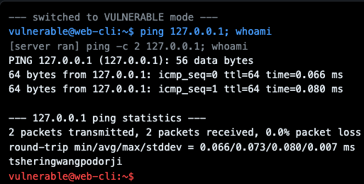

**AND chaining (`&&`):** the same kind of payload is first **blocked** in secure mode, then in vulnerable mode it reads `../private/secrets.txt` from outside the sandbox and leaks `DB_PASSWORD` and `API_KEY`.

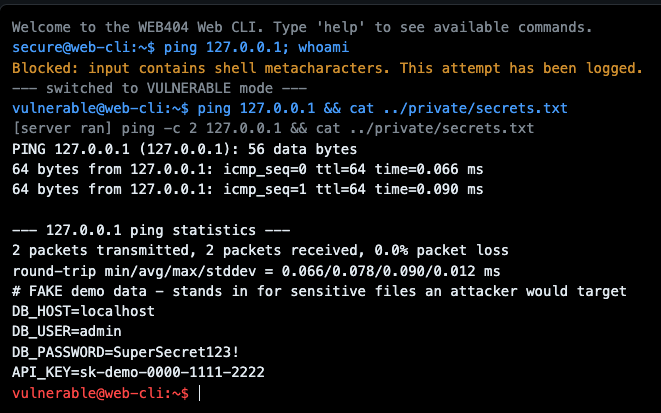

**Command substitution (backticks and `$()`):** the shell runs `uname -a` and `whoami` first and echoes the results. This reveals the OS, kernel version and CPU architecture.

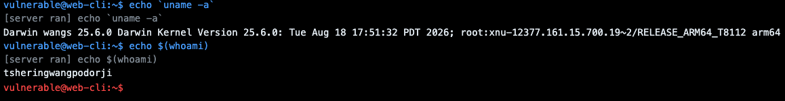

The pipe (`| id`) and `ls ..; cat /etc/passwd` payloads are shown in the curl comparison in section 7.5.

### 7.4 Same payloads against secure mode

Every payload is rejected with `Blocked: input contains shell metacharacters. This attempt has been logged.` Nothing runs on the server, and no command output or error details are returned.

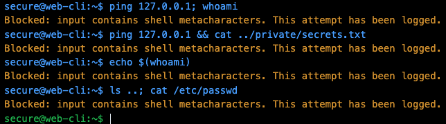

Bypass attempts that contain **no shell metacharacters** are still stopped by the deeper layers:

| Payload | Server response | Blocked by |
|---|---|---|
| `cat ../private/secrets.txt` | `Invalid file name. Use letters, numbers, ".", "_" or "-".` | File name allowlist / sandbox confinement |
| `ping -c 50 127.0.0.1` | `Options/flags are not allowed in arguments.` | Argument-injection check |
| `rm welcome.txt` | `Command not allowed: 'rm'. Type 'help' for the list.` | Command allowlist |
| `nslookup exa_mple..com` | `Invalid hostname or IP address.` | Hostname validation |

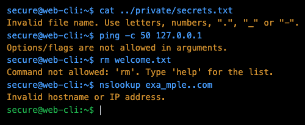

### 7.5 Side-by-side comparison with curl (`attack-demo.sh`)

`attack-demo.sh` sends six payloads to both endpoints. For every payload, the **VULNERABLE** endpoint returns `"ok":true` with the injected command's output: username, secrets file, `uid/gid` from `id`, kernel version, and the project directory listing. The **SECURE** endpoint returns `"blocked":true` every time.

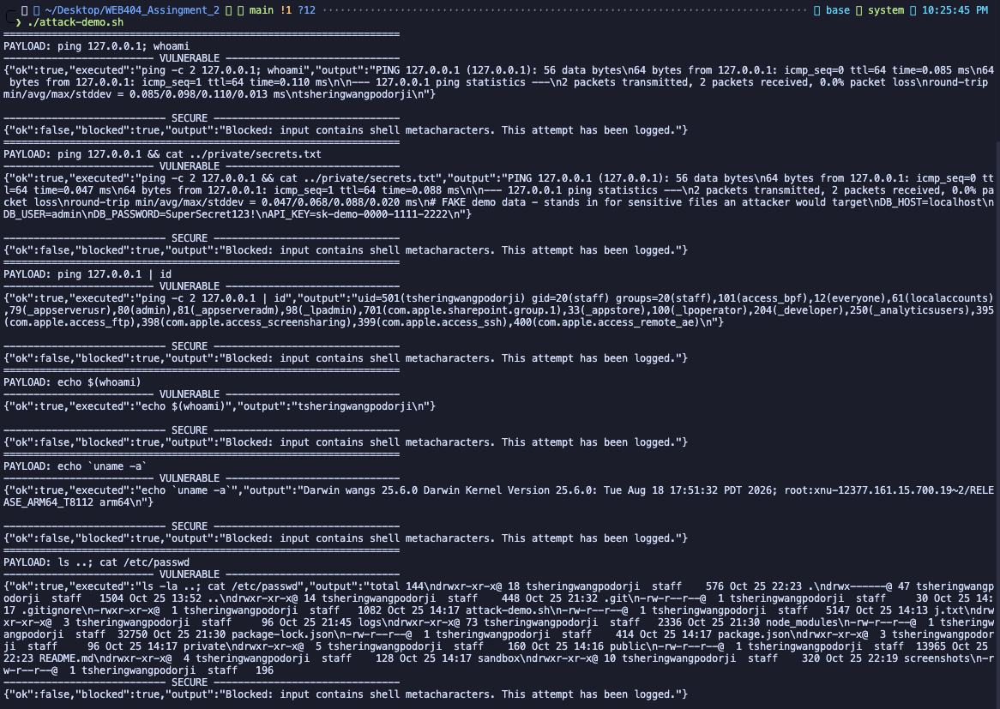

### 7.6 Audit log of blocked attempts

```bash
cat logs/audit.log
```

Each line is a JSON record with a timestamp, client IP and event. Legitimate commands are logged as `EXECUTED`. Every rejected request is logged as `BLOCKED` with the reason it was stopped:

| Reason | Meaning |
|---|---|
| `INJECTION_ATTEMPT` | Shell metacharacters found (`;`, `&&`, `\|`, `$()`, backticks…) |
| `INVALID_ARGUMENT` | Argument failed validation (path traversal, bad hostname) |
| `ARGUMENT_INJECTION` | Argument started with `-` (e.g. `ping -c 50`) |
| `NOT_ALLOWLISTED` | Command is not on the allowlist (e.g. `rm`) |

This gives administrators a record of attack attempts for monitoring and incident response, while the attacker only sees a generic message.

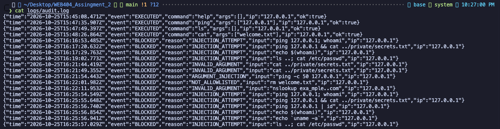

### 7.7 Automated tests

`npm test` result: **20 tests, 20 passed, 0 failed**. The tests cover each injection technique, argument injection, path traversal, unicode tricks, input length, allowlist bypass, stack-trace leakage, and confirm that legitimate commands still work.

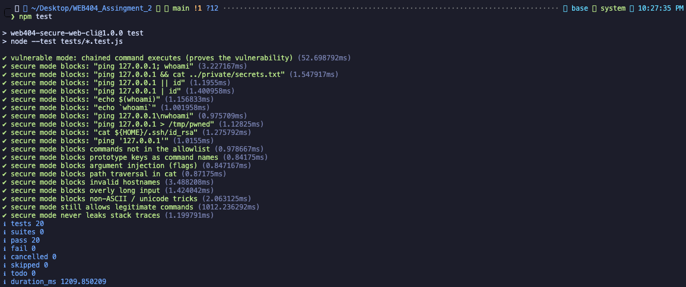

### 7.8 Rate limiting and security headers

```bash
for i in $(seq 1 35); do curl -s -o /dev/null -w "%{http_code} " -X POST http://127.0.0.1:3000/api/secure/run -H 'Content-Type: application/json' -d '{"command":"date"}'; done; echo
curl -sI http://127.0.0.1:3000
```

The first 30 requests return `200`, and requests 31–35 return **`429 Too Many Requests`**, so automated fuzzing of the CLI is throttled. The response headers set by Helmet include `Content-Security-Policy` (blocks inline/third-party scripts), `X-Frame-Options: SAMEORIGIN` (clickjacking), `X-Content-Type-Options: nosniff`, `Referrer-Policy: no-referrer` and `Strict-Transport-Security`. The `X-Powered-By: Express` header is removed, so the server technology is not advertised.

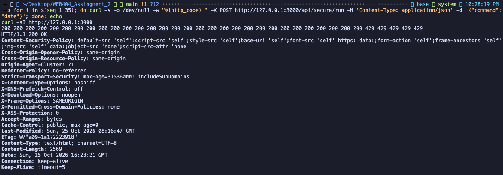

### 7.9 Request inspection in Browser DevTools

The Network tab shows the `run` request for a blocked payload. The **Payload** tab shows what the browser sent: `{"command": "ping 127.0.0.1; whoami"}`. The **Response** tab shows the server's reply (HTTP `400`), `"blocked": true`, with only a generic message. No command output and no stack trace are returned.

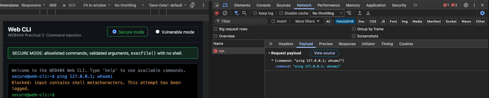

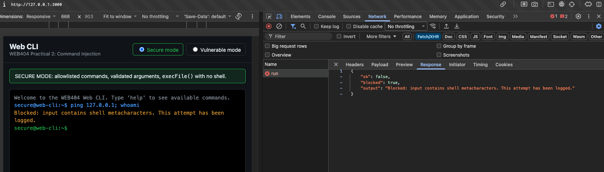

## 8. Discussion

- **Why the vulnerable version fails:** checking that the input *starts with* `ping` gives a false sense of security. The shell still reads the whole string, so anything after `;`, `&&`, `|` or inside `$()` runs as well.
- **Why a blocklist alone is not enough:** attackers can use encodings, newlines, `${IFS}`, unicode look-alikes, or **argument injection**, which needs no metacharacters at all. In this project the metacharacter filter is only an early-warning layer. The real protection comes from **allowlisting** and **not using a shell** (`execFile` with an argument array).
- **Least privilege:** in production the app should also run as a dedicated low-privilege user, inside a container, with a read-only filesystem. Then even an unknown bug would have very limited impact.
- **Information disclosure (2.4):** the vulnerable version returns `err.stack` and the exact command line, which helps an attacker. The secure version returns generic messages and keeps the details in the audit log.

## 9. Conclusion

A web-based CLI was built and exploited with common OS command-injection techniques. Through it, an attacker could read secret files, identify the server user and OS, and list system accounts. The secure version uses a command allowlist, strict argument validation, argument-injection and path-traversal protection, shell-free `execFile`, least-privilege execution limits, generic errors, audit logging and rate limiting. With these in place, all tested payloads were blocked and legitimate commands kept working. The 20 passing automated tests confirm this.

## 10. References

- OWASP – Command Injection: https://owasp.org/www-community/attacks/Command_Injection
- OWASP Cheat Sheet – OS Command Injection Defense: https://cheatsheetseries.owasp.org/cheatsheets/OS_Command_Injection_Defense_Cheat_Sheet.html
- PortSwigger Web Security Academy – OS command injection: https://portswigger.net/web-security/os-command-injection
- Node.js docs – child_process: https://nodejs.org/api/child_process.html
- CWE-78: Improper Neutralization of Special Elements used in an OS Command
